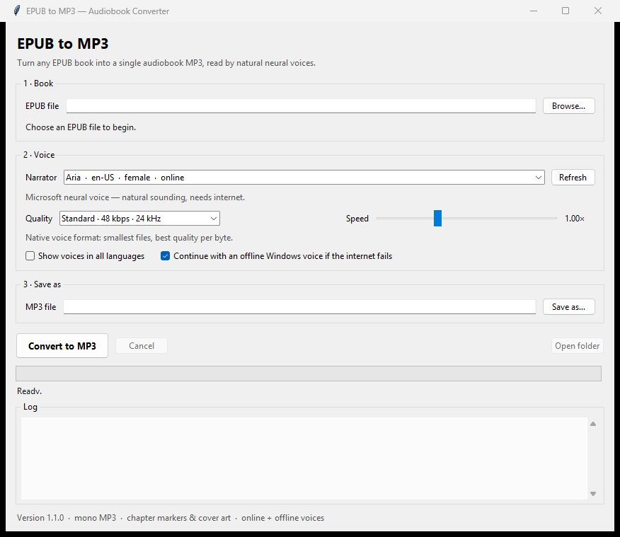

# EPUB → MP3 — Audiobook Converter for Windows

Turns an EPUB book into **one continuous MP3 audiobook**, narrated by natural-sounding Microsoft
neural voices, with chapter markers, book metadata and cover art embedded in the file.

A small Tkinter desktop app with a command-line mode, packaged as a single `.exe` with PyInstaller.
The build recipe is in [Building from source](#building-from-source).



---

## Features

* **One MP3 file** per book — easy to copy to a phone, USB stick or car radio.
* **Three audio quality presets** — 48 kbps at 24 kHz (native voice format, smallest), or
  64 / 128 kbps at 44.1 kHz (standard MP3 that plays in every player, including older car stereos).
* **Natural neural voices** — 300+ Microsoft Edge voices, 47 of them English (US, UK, AU, CA, IN, IE, NZ, ZA).
* **Works offline too** — falls back to the Windows voices installed on your PC if the internet drops
  (or pick an offline voice from the start).
* **Chapter markers** (ID3 `CHAP`/`CTOC`) — jump between chapters in VLC, foobar2000, Poweramp, etc.
* **Title, author, year, cover** read from the EPUB and written into the MP3 tags.
* **Speed control** from 0.5× to 2×.
* **Smart text handling** — removes page numbers, Project Gutenberg boilerplate, duplicate chapter
  headings and illustration placeholders; splits text at sentence boundaries for natural pauses.
* **Resumable-free and safe** — temp files are cleaned up, a failed run never deletes an existing MP3.
* **Self-contained build** — PyInstaller produces one executable that needs no Python on the target machine.

## Quick start

Requires **Python 3.13 on Windows** — the offline voices go through SAPI via `pywin32`.

```bat
python -m venv .venv
.venv\Scripts\pip install -r requirements.txt
.venv\Scripts\python src\launcher.py
```

Or as a module:

```bat
set PYTHONPATH=src
.venv\Scripts\python -m epub2mp3
```

Then:

1. **1 · Book** → *Browse…* and pick your `.epub`.
2. **2 · Voice** → choose a narrator and an audio quality (the list shows *online* and *offline* voices).
3. **3 · Save as** → the file name is filled in automatically; change it if you like.
4. Press **Convert to MP3** and watch the progress bar. When it finishes, use **Open folder**.

Long books take a while: roughly **5× faster than real time** with online voices, so a 3-hour
audiobook needs about 35–45 minutes of conversion.

## Audio quality

Pick **Quality** in the Voice panel:

| Preset | Bitrate | Sample rate | Size per hour | Notes |
|---|---|---|---|---|
| Standard | 48 kbps | 24 kHz | ≈ 21 MB | Native voice format, best quality per byte |
| Compatible | 64 kbps | 44.1 kHz | ≈ 28 MB | Standard MP3, plays in every player |
| Maximum | 128 kbps | 44.1 kHz | ≈ 56 MB | Highest bitrate and widest compatibility |

The neural voices are synthesised at 24 kHz. The two 44.1 kHz presets are produced with a
polyphase resampler and the LAME encoder, so they are ordinary standard MP3 files rather than
24 kHz streams. All presets are mono 16-bit audio with ID3v2.3 tags, cover art and chapter
markers; a 10-hour book is 210 MB (standard), 280 MB (compatible) or 560 MB (maximum).

## Voices

**Online (neural, best quality)** — requires an internet connection. The catalogue is downloaded
from Microsoft and cached for a week; press **Refresh** to update it. Recommended English voices:

| Voice | Accent | Style |
|---|---|---|
| `en-US-AriaNeural` | US | warm, natural (default) |
| `en-US-JennyNeural` | US | friendly |
| `en-US-AvaNeural` | US | expressive |
| `en-US-AndrewNeural` | US | deep, calm |
| `en-US-GuyNeural` | US | male, clear |
| `en-GB-SoniaNeural` | British | soft |
| `en-GB-RyanNeural` | British | male |
| `en-AU-NatashaNeural` | Australian | bright |

Tick **Show voices in all languages** to narrate books in other languages.

**Offline** — whatever is installed in Windows (*Settings → Time & language → Speech*). These sound
more robotic but work with no internet at all.

## Command line (optional)

The same program converts without opening a window — handy for scripting:

```bat
python src\launcher.py "C:\Books\Dune.epub" --convert --out "C:\Books\Dune.mp3"
python src\launcher.py "C:\Books\Dune.epub" --convert --bitrate 128 --out "C:\Books\Dune.mp3"
python src\launcher.py "C:\Books\Dune.epub" --convert --offline --out "C:\Books\Dune.mp3"
```

| Option | Meaning |
|---|---|
| `--convert` | run headless, no window |
| `--out PATH` | output MP3 (default: next to the EPUB) |
| `--voice ID` | e.g. `en-US-AriaNeural` |
| `--quality NAME` | `standard`, `compatible` or `maximum` |
| `--bitrate N` | shortcut for `--quality`: `48`, `64` or `128` |
| `--offline` | use a Windows offline voice |
| `--rate N` | speed in percent, `-50` … `100` |
| `--no-fallback` | fail instead of switching to an offline voice |
| `--quiet` | only errors |
| `--version` | print the version |

Headless runs started without a console (for example from a shortcut) write their log to
`%LOCALAPPDATA%\EpubToMp3\logs\headless.log`.

## Where things are stored

* **Settings** (last voice, speed, folders): `%LOCALAPPDATA%\EpubToMp3\settings.json`
* **Voice cache**: `%LOCALAPPDATA%\EpubToMp3\voices.json`
* **Temporary audio** during a conversion: `%TEMP%\epub2mp3-*` (deleted automatically)

Nothing else is written to the registry.

## Troubleshooting

**“Windows protected your PC”** — an exe you build yourself is not code-signed, so SmartScreen
shows this warning the first time. Click **More info → Run anyway**.

**Online voice errors / “could not load online voices”** — check the internet connection. A proxy or
firewall that blocks `speech.platform.bing.com` will stop neural voices; the offline voices still
work. Tick the fallback box to let a conversion continue offline automatically.

**“No readable text was found”** — the EPUB is image-only (scanned), DRM-protected, or damaged.
DRM-protected books cannot be converted.

**Some chapters are missing** — very short sections (< 350 characters) are merged into the previous
chapter, and front-matter/table-of-contents pages are skipped on purpose.

**The MP3 shows no chapters** — chapter markers are stored as ID3v2.3 `CHAP` frames; Windows Media
Player ignores them, VLC/foobar2000/Poweramp show them.

**The MP3 will not play in my car stereo / old player** — some devices reject 24 kHz MPEG-2 files.
Choose the **Compatible** (64 kbps) or **Maximum** (128 kbps) preset: those are standard 44.1 kHz
MP3 files and play almost everywhere.

## Building from source

Python 3.13 on Windows:

```bat
py -3.13 -m venv build\venv
build\venv\Scripts\pip install -r requirements.txt pyinstaller
build\venv\Scripts\pyinstaller --noconfirm --clean --onefile --windowed ^
  --name EpubToMp3 --paths src ^
  --hidden-import win32com.client --hidden-import pythoncom --hidden-import pywintypes ^
  --hidden-import soundfile --hidden-import _soundfile ^
  --workpath build\pyi --specpath build --distpath dist src\launcher.py
```

Add `--icon <path.ico>` if you want a custom icon; no icon file ships with the repo.

Source layout:

```
src/epub2mp3/epub.py      EPUB parsing (stdlib only)
src/epub2mp3/textproc.py  text clean-up, sentence splitting, chunking
src/epub2mp3/engines.py   Edge neural TTS + Windows SAPI, LAME encoding
src/epub2mp3/audio.py     MP3 decoding and polyphase resampling to 44.1 kHz
src/epub2mp3/mp3tool.py   MP3 frame parsing, duration, ID3 chapters, muxing
src/epub2mp3/convert.py   conversion pipeline
src/epub2mp3/gui.py       Tkinter interface
src/epub2mp3/__main__.py  CLI / headless mode
```

## Notes and privacy

* Online voices send the book text to Microsoft's speech service. Offline voices keep everything on
  your PC — use `--offline` or pick an offline voice for confidential books.
* This is an independent tool and is not affiliated with Microsoft, Project Gutenberg or any
  bookstore. Microsoft, Edge and Windows are trademarks of Microsoft Corporation.
* Please respect the copyright of the books you convert.
